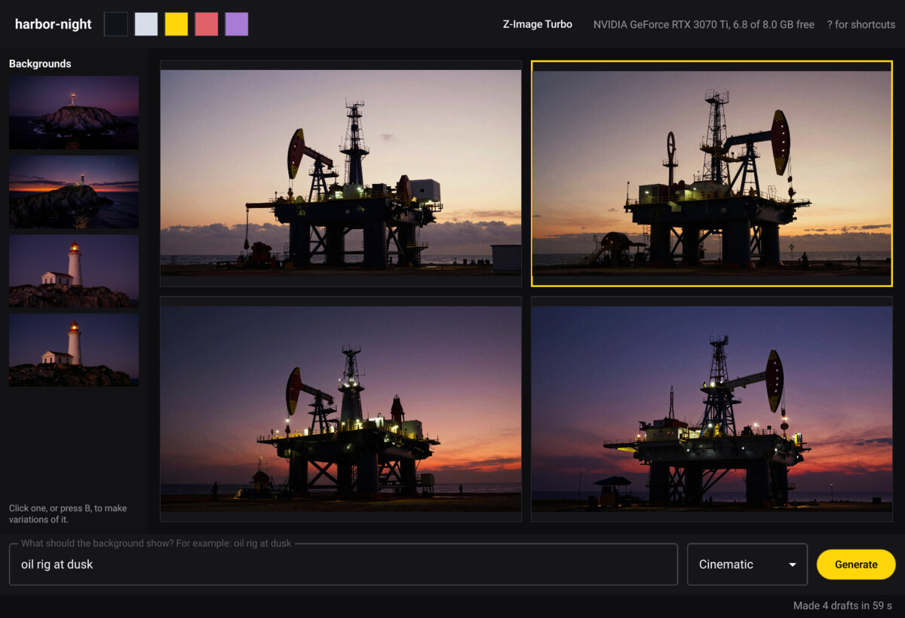

# limgen



limgen (Local IMage GENeration) makes desktop backgrounds for the current
[Omarchy](https://omarchy.org) theme with an image model that runs on your own
GPU, and adds the ones you keep to that theme's backgrounds, where Omarchy's
background cycling picks them up.

There is no account, no cloud service and no telemetry. limgen goes online
only to download a model, after showing you its size and licence and asking.

## What it does

- You type a subject, such as "oil rig at dusk". limgen makes four drafts
  whose prompt carries the theme's colours and mood, and shows each one taking
  shape as it is made.
- You keep the drafts you like. A kept draft is upscaled to your largest
  monitor, moved a little toward the theme's colours, and added to
  `~/.config/omarchy/backgrounds/<theme>/` as a new `limgen-*` file. limgen
  never changes your theme, its files or any other background.
- You make variations of a theme's own backgrounds, or of anything you made,
  to get more images that clearly belong to the theme.
- Every image records the prompt, seed, model and theme it was made with, so
  it can be made again or varied later.
- Everything the window does is also a command, for scripts and coding
  agents.

## What it needs

- Omarchy on Arch Linux. limgen also runs without Omarchy, with the default
  accent, no palette, and kept images in `~/Pictures/limgen/`.
- A GPU with Vulkan (NVIDIA, AMD or Intel) and about 5 GB of free video
  memory. It was developed on an 8 GB NVIDIA card, where a batch of four
  drafts takes about a minute. AMD and Intel cards are expected to work but
  have not been tested yet.
- About 7 GB of disk for the default model.
- An x86-64-v3 processor (Haswell, 2013, or newer) for the packaged engine.

## Install

limgen is not in Omarchy's package repository yet. From a checkout:

```sh
bin/install                                  # limgen and its Vulkan engine
LIMGEN_ENGINES="vulkan cuda" bin/install     # also a CUDA engine (needs the cuda package)
```

`bin/install` builds the packages with `makepkg` and installs them, so limgen
appears in the app launcher. The engine is stable-diffusion.cpp's `sd-cli`,
built at the one release limgen is made for. On NVIDIA, the Vulkan engine was
4% slower than CUDA in our tests and needs no CUDA install, so it is the
default everywhere.

## First run

The window checks the engine and the GPU, then proposes the default model
with its download size, its licence and the free disk space. Press Download;
the download can be paused and resumes where it stopped. The first batch
measures how fast your machine is, and limgen shows an estimate before every
batch after that.

| Model | Size | Licence | |
|---|---|---|---|
| Z-Image Turbo | 6.7 GB | Apache 2.0 | the default |
| FLUX.2 klein 4B | 5.3 GB | Apache 2.0 | faster, about 5 s a draft |

Both share one text encoder, so the second one costs less to add. Keeping
uses Real-ESRGAN x4plus (67 MB, BSD 3-Clause), downloaded with the first
model. `docs/models.md` says how these were chosen.

## Keys

| Key | Action |
|---|---|
| Space | Generate (or Enter in the subject field) |
| Esc | Close what is open, leave a field, cancel the batch, or stop making variations |
| Arrow keys | Move between drafts |
| F | Show the selected image full size |
| K | Keep: finish it and add it to the theme's backgrounds |
| S | Keep it and show it as the background now |
| D | Discard the selected draft |
| Ctrl+Z / Ctrl+Shift+Z | Undo or redo the last keep or discard |
| V | Variations of the selected image |
| B / Shift+B | Make variations of the theme's next or previous background |
| L | Show or hide the library |
| R | The same prompt again, with new seeds |
| M | Choose the model |
| P | Show or hide the full prompt and how kept images are finished |
| ? | Show every shortcut |
| Q | Quit (asks first while a batch, a keep or a download runs) |

## Commands

Every command needs no display, writes errors to stderr, and exits 0 on
success, 1 on an error, 2 on bad arguments, 3 when this machine cannot run
it, and 130 when interrupted. All but `skill` take `--json`.

| Command | Does |
|---|---|
| `limgen` or `limgen open` | Opens the window |
| `limgen palette` | The theme's palette and the words it becomes in prompts |
| `limgen doctor [--verify]` | The engine, the GPU, the models, and what is missing |
| `limgen models` | The models, installed or not, and whether they run here |
| `limgen models pull <id>` | Downloads a model after showing its licence and size |
| `limgen generate "<subject>"` | Makes drafts for the current theme |
| `limgen generate --from <id-or-file> --strength 0.5` | Makes variations of an image |
| `limgen keep <id> [--set]` | Finishes a draft and adds it to the theme's backgrounds |
| `limgen set <id-or-file>` | Shows an image as the background now |
| `limgen library [--theme <slug>]` | Lists everything limgen made |
| `limgen skill install` | Installs a skill so coding agents can use limgen |

`limgen help <command>` lists a command's options.

## Where things go

| Path | Contents |
|---|---|
| `~/.config/omarchy/backgrounds/<theme>/limgen-*` | the backgrounds you kept |
| `~/.local/share/limgen/library/` | every draft and finished image, with its prompt and settings |
| `~/.local/share/limgen/models/` | downloaded models |
| `~/.config/limgen/config.json` | the model, style and finishing settings you chose |

## Languages

The window follows the language chosen in Omarchy's settings. It speaks
English, German, French, Mexican Spanish, Brazilian Portuguese, Japanese and
Simplified Chinese so far; the translations were made with a language model
and corrections are welcome. Commands always answer in English.

## Development

```sh
bin/build                       # build/limgen
bin/test                        # the test suite, offscreen, with a fake engine
bin/build-engine vulkan         # sd-cli at the pinned release, in build/engine/vulkan/
LIMGEN_SD_CLI=bin/fake-sd-cli build/limgen   # the window without a GPU
```

`docs/design.md` says what limgen does and why, `docs/technical.md` how it
is built, and `docs/models.md` which models it runs and why.

## Licence

limgen is MIT licensed. The engine packages carry stable-diffusion.cpp's MIT
licence and those of the libraries built into it. Models come with their own
licences, which limgen shows before downloading them.
